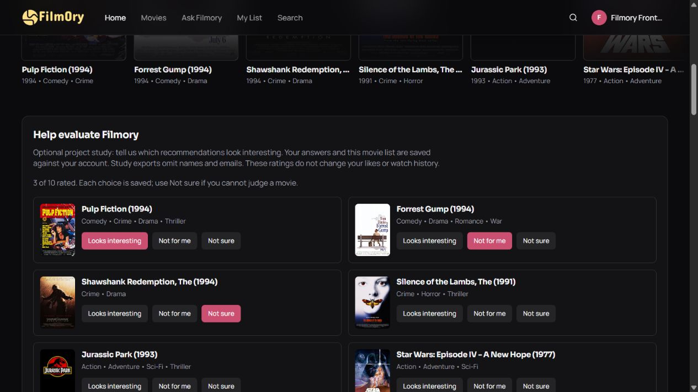

# Filmory pipeline quality evaluation — 14 October 2026

The custom DAMR algorithm exists in `backend/app/ml/damr.py` and is used by Ask Filmory. The homepage defaults to the validated fixed/maturity-based policy. This pass evaluated alternatives; **none met the predeclared held-out promotion criterion, so the serving policy remains unchanged.**

## Protocol

Frozen clean checkpoint bundle; 300 validation users and 1000 additional test users. All five scenarios use the same cohorts. Users have at least 20 train events, permitting comparable 2/5/10/20-event contexts. Validation targets and fresh test targets remain distinct. The full mapped catalogue has 22,836 items; observed history is excluded.

The weight grid uses a 0.1 simplex step plus the current weights, candidate budgets 100/300/1,000, and Transformer/collaborative/mixed retrieval. All validation choices were saved before the test phase. Recorded earlier cohorts, including protocol-only reservations from interrupted runs, were excluded. A test-phase inference-mode execution failure was corrected and resumed from the locked selection; choices/cohort were not retuned. Both original and resumed source snapshots are retained.

These are existing training users and catalogue items. Short-history scenarios hide the requester embedding; they are simulations of a new account, not evidence about entirely unseen people. No new training, cloud inference or checkpoint changes occurred.

## Mapped-user model comparison

| System | Full-catalogue HR@10 | NDCG@10 | Candidate recall |
|---|---:|---:|---:|
| NCF Baseline | 4.40% | 0.024587 | 19.70% |
| Hybrid NCF | 5.10% | 0.027486 | 22.20% |
| Transformer | 4.70% | 0.022270 | 28.90% |
| Current normalized ensemble (100 candidates) | 6.60% | 0.028675 | 28.90% |
| Validation-selected ensemble (300 candidates) | 6.50% | 0.029099 | 52.10% |

The current path misses the held-out target during retrieval for **711 of 1,000 users**. For **223**, it retrieves the target but ranks it below the top ten; **66** are hits. Both retrieval and final ranking limit the pipeline. Candidate recall is measured at each path’s declared budget.

Widening the selected pool raises candidate recall from 28.9% to 52.1%, but top-ten hits change from 66 to 65. More retrieved targets alone do not establish better final recommendations.

## Validation-selected alternatives versus current policy

| Scenario | Selected pool / retrieval / weights | Test HR@10 current → selected | Test NDCG@10 current → selected | Promote? |
|---|---|---:|---:|---|
| mapped | 300 / transformer / [0.6, 0.3, 0.1] | 6.60% → 6.50% | 0.028675 → 0.029099 | No |
| live_2 | 100 / collaborative / [0.2, 0.5, 0.3] | 3.60% → 2.80% | 0.014910 → 0.012741 | No |
| live_5 | 300 / transformer / [0.6, 0.2, 0.2] | 4.30% → 4.60% | 0.018475 → 0.019481 | No |
| live_10 | 100 / transformer / [1.0, 0.0, 0.0] | 4.40% → 4.70% | 0.021341 → 0.023498 | No |
| live_20 | 300 / transformer / [0.2, 0.8, 0.0] | 4.70% → 4.60% | 0.020248 → 0.019830 | No |

Mapped weights are Hybrid NCF / Transformer / genre. Live-mode weights are neighbor / Transformer / genre; new accounts never borrow an existing learned NCF user embedding. All paired 95% intervals for selected-policy differences include zero. The predeclared rule requires positive lower bounds for both HR@10 and NDCG@10. These five comparisons are exploratory, not five independent replications or a prospective satisfaction test.

## DAMR: custom method and controlled ablations

DAMR uses long/short genre profiles to estimate drift, focus, maturity and freshness; a calibrated softmax gate adapts expert weights. A momentum vector adds directional genre relevance, expert agreement adjusts confidence, and optional quality/MMR components control popular-quality priors and redundancy. The combination is Filmory’s proposed custom method. It is not proof of worldwide novelty. Hybrid NCF and Transformers are established model families. MMR is an established component, not an invention of Filmory ([Goldstein and Carbonell, 1998](https://aclanthology.org/X98-1025/)).

For this experiment, every ablation uses the identical 100 Transformer candidates and full-catalogue held-out target. State uses positional decay with freshness zero because prediction-time timestamps are not available in the serving bundle. Bayesian quality is disabled because there are no train-only per-movie ratings/counts; importing catalogue ratings could introduce unsupported evidence or leakage. This is not a complete test of the live timestamp/quality configuration.

| Ablation | HR@10 | NDCG@10 | Intra-list diversity |
|---|---:|---:|---:|
| Fixed on DAMR pool | 6.60% | 0.028675 | 0.743434 |
| DAMR gate | 6.80% | 0.029379 | 0.744105 |
| DAMR + momentum | 6.80% | 0.030006 | 0.744219 |
| DAMR + agreement | 6.40% | 0.027927 | 0.734317 |
| DAMR + diversity | 5.90% | 0.026923 | 0.804650 |

Gate/momentum variants show small descriptive ranking gains; agreement/diversity have relevance trade-offs. Do not select a new default from these already inspected test ablations. Exploratory paired intervals are retained in `damr-paired-uncertainty.json`; a separate validation/confirmation protocol would be needed before promoting a modified DAMR variant.

## Local feedback and next evidence

The homepage now has an optional **Help evaluate Filmory** review. It freezes the displayed list and policy snapshot, stores per-movie interesting/not-for-me/unsure judgments with account ownership checks, and supports local exports without names/emails. QA ratings are excluded. Actual classmate participation is pending; software tests are not participants. See `docs/verification/classmate-feedback-guide.md`.

## Paper-ready interpretation

> Filmory implements DAMR as a proposed deterministic re-ranking method combining drift-conditioned expert fusion, taste momentum and agreement, with standard optional quality and diversity components. On a fresh 1,000-user full-catalogue replay, the current normalized ensemble achieved HR@10 of 0.066 and NDCG@10 of 0.028675. Validation-selected wider retrieval improved candidate recall but did not demonstrate a reliable gain in final ranking. Controlled DAMR ablations reveal relevance/diversity trade-offs rather than uniform superiority. These results concern transductive offline replay and do not establish prospective satisfaction or overall accuracy.

The earlier 90.75% sampled Transformer HR@10 and 3.50% full-catalogue result are from a different cohort/protocol. Keep them separate; do not overwrite the historical measurements with this serving experiment. The existing LaTeX manuscript was not modified in this pass.

## Artifacts and verification

Evaluation: `evaluation/pipeline_quality_20261014_final`. Includes pre-test protocol/selection, per-user validation and test rows, metrics, paired uncertainty and source/checkpoint hashes. The active serving overlay remains unchanged.

Backend regression/migration/evaluation/study checks: 79 passed. Frontend API tests: 9 passed. TypeScript and client/SSR build passed; lint has zero errors and eight existing Fast Refresh warnings. Study ownership, explicit consent, frozen slate preservation, vote replacement and QA export exclusion are tested.

Final affected study/migration/evaluation checks also passed (5 tests). The live
homepage QA review saved three distinct choices against ten frozen titles, kept
likes/history unchanged, and completed through the keyboard. Six read-only live
checks passed. Its answers were excluded from the initial participant export,
which contains zero human participants. Real classmate responses remain pending.

