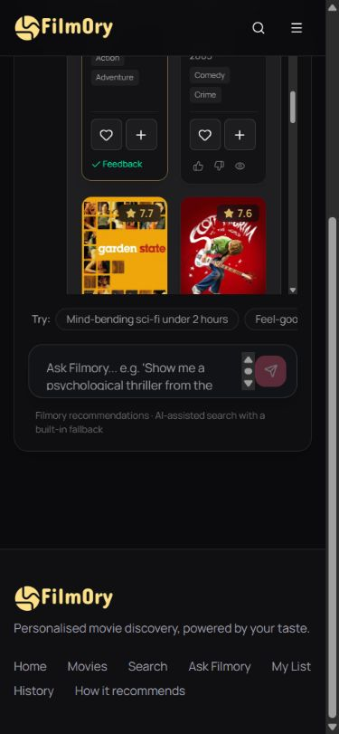

# Local frontend verification — 14 October 2026

Filmory was checked at `http://127.0.0.1:5173/` against its running backend at `http://127.0.0.1:8100/`. PostgreSQL and all three active models were healthy. Functional browser checks used a newly created **Filmory Frontend QA** account, with simulated activity separate from existing accounts. No checkpoint training or research-metric update was performed.

## Bugs corrected

- Login, demo login and registration now catch failed requests, display persistent accessible error messages and release pending buttons for retry. Previously an invalid login produced an unhandled rejection and disabled both sign-in buttons indefinitely. Invalid-password registration and duplicate-email registration were verified after the correction.
- Movie lookup treats only HTTP 404 as a missing title. Network/server failures now reach the existing retry UI instead of being mislabeled as an absent movie. Invalid movie route parameters show a missing-title state without requesting a `NaN` item.
- Onboarding uses the shared poster component with artwork fallback. Genre instructions now match the actual one-or-more selection requirement.
- The mobile Ask Filmory conversation drawer now has accessible open/close controls, backdrop dismissal and Escape handling. Selecting a saved conversation and starting a new chat close the drawer. Conversation selection is keyboard-operable.
- Assistant card action/feedback rows wrap on narrow screens, preventing clipped feedback controls.
- Model transparency identifies the active Transformer candidate retriever and distinguishes Hybrid NCF fusion and new-account history policies. An unused default component export was removed to permit route splitting.

## Browser checks

| Flow | Observed result |
|---|---|
| Guest home | Movie rails and guest recommendation feed loaded. |
| Login | Invalid credentials display an error and leave controls usable; valid QA login works after rejection. |
| Registration | Short password and duplicate email errors are recoverable; a valid new account routes to onboarding. |
| Onboarding | Four steps complete; selected genres and two favourite movies persist through `/api/auth/me`. |
| Home personalization | Initial QA feed reflects preference-based cold start. Two distinct mapped plays activate `sequence_only` ranking. |
| Movie details / similarity | Matrix and Terminator 2 pages render metadata, actions and similar titles. Invalid ID routes show a missing-title state. |
| Likes / watchlist | Like/save persist after navigation; unlike/remove update button state and leave an empty watchlist after navigation. |
| History | Two simulated plays persist; history displays title and timestamp. Playback remains simulated. |
| Catalogue | 48 cards initially; Load more expands to 96. Combined Sci-Fi + title sort + Matrix filter returns four titles. |
| Search | Matrix returns four results; an unknown query displays an explicit no-results state. |
| Profile | Selected genres, one saved title, two watched titles, live taste diagnostics and recommendation rails render before removal checks. |
| Model page | Active retrieval explanation, sampled ranking table and separate full-catalogue metrics render. |
| Ask Filmory | One live query for comedy after 2000, runtime at most 120 minutes, without horror returns ten movies. Persisted movie metadata satisfies these constraints. |
| Chat persistence | Conversation listing and reopening restore the transcript and movie cards. |
| Chat feedback / filters | Helpful feedback receives confirmation; runtime-filter removal updates active filters. |
| Mobile | Tested at 390 × 844. Navigation reaches profile; conversation drawer opens and closes, including Escape. Feedback controls fit the cards. Viewport override was reset afterward. |
| Logout / guards | Sign out routes to login; an unauthenticated watchlist visit redirects to login. |

## Automated evidence

- Frontend API-client tests: **7 passed**, including absent-title versus service-failure handling, 204 responses, session restoration and stale-session guards.
- Backend API, recommendation integration and assistant-constraint regression subset: **45 passed**. These use isolated test databases and provider stubs; they are separate from the live checks.
- Live local API checks: **21 before the second mapped play**, then **25 after**, covering account preferences, catalogue/search/sort, guest and mapped-demo recommendations, similar items, exclusions, valid scores, metrics, taste state, sequence-policy activation and one assistant constraint query. Reports are `tools/frontend-verification/live-checks-before.json` and `live-checks-after.json`.
- Frontend TypeScript check: passed.
- Frontend client/SSR build: passed.
- ESLint: **0 errors, 8 existing Fast Refresh warnings** in shared UI/context modules. Backend tests also emit upstream deprecation/prototype warnings.
- The initial invalid-login error was reproduced before repair. Subsequent repaired-flow checks did not produce a new unhandled application exception. Expected rejected HTTP requests remain part of error-path testing.

## Limits of this verification

These are functional checks with recorded scenarios, not a proof that every browser, input or future provider response will work. Valid ranked responses and consumed-title exclusion do not establish that every suggested movie matches a person's taste. The live assistant constraint check is one query; the larger constraint regression uses isolated fixtures.

Gemini is an external dependency. The running server had earlier logged a provider 503 and used fallback handling; universal provider availability is not certified. Movie artwork and fonts can also depend on external hosts; the shared poster component handles missing/failed artwork.

Saved conversation restoration currently reconstructs cards from stored movie IDs and catalogue metadata. Original per-response scores and detailed evidence panels are not retained in those stored messages. The transcript and movie list persist, but reopening a conversation is not a replay of every original response field. This behavior was identified and recorded; no database-schema expansion was made in this frontend check.

No existing user's preferences, history or messages were intentionally mutated. The QA account is removed by the narrowly scoped cleanup script, with a separate cleanup report. The application servers remain running for manual local testing.

## Reproduce automated checks

```powershell
cd E:\Filmory\frontend
npm test
npm run typecheck
npm run lint
npm run build

cd E:\Filmory\backend
.\.venv\Scripts\python.exe -m pytest tests/test_api.py tests/test_api_regressions.py tests/test_recommender_integration.py tests/test_assistant_constraints.py -q
```

The live-check script expects the dedicated QA fixture created through the UI: name `Filmory Frontend QA`, email prefix `filmory.frontend.qa.` at `example.com`, the script's test-only password, genres Sci-Fi/Comedy/Thriller, favourites 2571/589, and two recorded plays before the `after` phase. It logs in only to that fixture and does not print or save bearer tokens. It performs read-only API checks except for login/demo authentication. Its title-sort check follows PostgreSQL collation rather than incorrectly requiring Python Unicode ordering.


