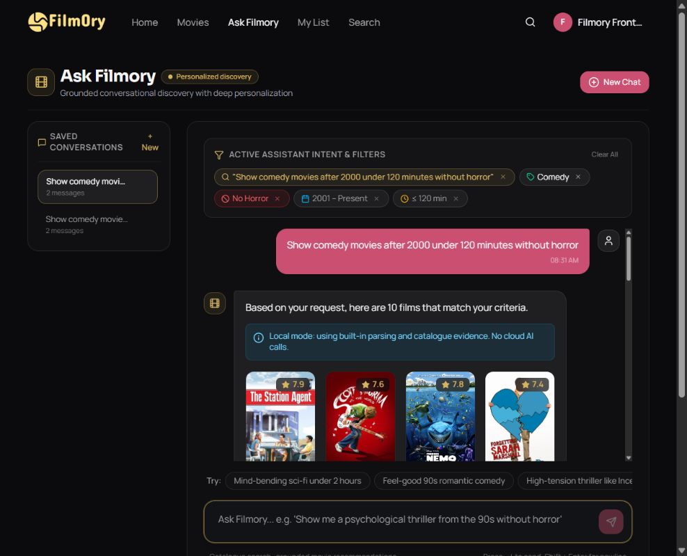

# Recommendation improvements with no paid services

Filmory continues to use its existing local PyTorch checkpoints and PostgreSQL
catalogue. This work does not train new checkpoints or claim a new accuracy score.

## Changes

- **Not interested / Show again:** an authenticated user's latest movie decision
  is stored in the existing interaction log. Rejected titles are excluded from
  personalized cold-start, sequence, mapped-model and assistant recommendations.
  Home and similar-title rails also filter them in the browser. Search and
  catalogue browsing remain available so users can find and restore a title.
- Movie pages, movie cards and assistant cards offer the control. The profile has
  a **Hidden from Recommendations** row for undo. Saved lists and watch history
  are retained. Hiding removes a current like; restoring visibility does not
  invent a new like. A single rejected movie does not ban its entire genre.
- **Cold-start correction:** exclusion IDs and positive seed movies are separate.
  Previously all excluded activity was passed as favourite seed movies. A hidden
  or withdrawn title must not increase interest in its genre or similar movies.
- **Current history signals:** removed likes and hidden titles do not enter the
  live sequence or DAMR history. Each movie contributes its latest positive event
  once, in chronological order with a deterministic ID tie-breaker. Repeated Play
  clicks do not multiply a movie's genre contribution. Playback remains simulated;
  it is activity rather than evidence of enjoyment.
- **Candidate integrity:** mapped and cold-start retrieval spend the candidate
  budget on movies present in the local catalogue. Exhausted mapped recommendations
  return an empty list instead of recycling consumed titles through popularity.
- **Local assistant by default:** `ASSISTANT_LOCAL_ONLY=true` bypasses cloud client
  construction, even if a Gemini key exists. The existing parser and deterministic
  catalogue-evidence explanations run locally. Users see a local-mode notice.
  Optional external artwork can still load; local mode applies to AI requests.
- Local year filters distinguish **after/before** (strict) from **since/up to**
  (inclusive), preventing boundary-year titles from violating the request.

## Cost and setup

No subscriptions, API purchases, cloud hosting, new Python packages or model
downloads are required for these changes. Existing local hardware, electricity
and internet for optional artwork remain ordinary running costs.

Local mode is the default in `backend/app/config.py` and `.env.example`. To make
it explicit for the current local server:

```powershell
cd E:\Filmory\backend
$env:ASSISTANT_LOCAL_ONLY='true'
.\.venv\Scripts\python.exe -m uvicorn app.main:app --host 127.0.0.1 --port 8100
```

Frontend setup uses the existing installation at `E:\Filmory\frontend`. The
application is available at `http://127.0.0.1:5173/`.

## Validation

- **74 backend tests passed:** API regressions, model integration, assistant
  constraints and acceptance scenarios. They use disposable SQLite catalogues.
- **8 frontend API tests passed.** TypeScript and client/SSR build passed. Lint
  has zero errors and eight existing Fast Refresh warnings.
- **33 live checks passed:** 17 with a rejected title and 16 after undo, using
  the dedicated browser QA account. Reports are
  `tools/recommendation-verification/live-hidden.json` and `live-restored.json`.
  Existing checkpoint hashes match the frozen serving policy.
- **Browser:** Matrix rejection survives page navigation/reload, the profile
  exposes it for undo, and Toy Story 3 rejection is respected by a fresh assistant
  request. Undo from the profile works. Ten returned movies satisfy Comedy,
  no Horror, year strictly greater than 2000 and known runtime at most 120 minutes.
  The local-mode notice appears. New rejection controls fit their cards at the
  tested viewport. QA data is removed with a separately recorded cleanup.

The first restricted backend run could not create pytest's system temporary
directory. The final run used a uniquely named workspace test folder and passed.
Upstream Starlette/PyTorch warnings remain; no test failures remain.



## Evidence and limits

The serving policy was already selected on validation data. It remains frozen;
making the candidate pool larger or reducing training loss without evaluation is
not assumed to improve relevance. Historical sampled/full-catalogue metrics and
the research paper remain historical evidence, not measurements of these new
feedback features. New feedback cannot improve MovieLens offline HR@10 until a
separate experiment measures it.

These changes guarantee tested handling of explicit feedback, not that every
movie will suit every person. Local parsing supports common titles, genres,
runtime/year/rating constraints and filter removal, but does not provide a
general-purpose cloud language model's full conversational capability. Saved
chat scores/evidence still have the previously documented restoration limitation.
